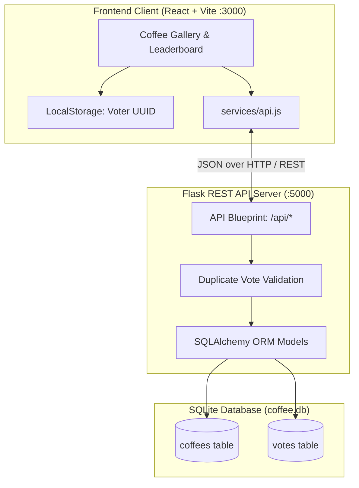

# ☕ BaristaPulse – Coffee Rating Application

[](https://www.python.org/)
[](https://flask.palletsprojects.com/)
[](https://react.dev/)
[](https://vitejs.dev/)
[](https://www.sqlite.org/)
[]()
[](https://opensource.org/licenses/MIT)

> **"Discover. Rate. Explore Coffee."**  
> Explore coffee blends from around the world and share your favorite flavors.

BaristaPulse is a full-stack, coffee-rating and discovery web application. It features a curated catalog of 50+ specialty single origins and blends from 20+ countries, an interactive 1-to-5 star cupping rating mechanism with duplicate-vote prevention, persistent SQLite database storage, dynamic leaderboard rankings, and platform analytics.

---

## 📑 Table of Contents

1. [Features](#-features)
2. [Technology Stack](#-technology-stack)
3. [Architecture Overview](#-architecture-overview)
4. [Database Design](#-database-design)
5. [REST API Documentation](#-rest-api-documentation)
6. [Folder Structure](#-folder-structure)
7. [Installation & Setup](#-installation--setup)
8. [Running the Application](#-running-the-application)
9. [Automated Testing](#-automated-testing)
10. [Screenshots & UI Showcase](#-screenshots--ui-showcase)
11. [Free Deployment Guide](#-free-deployment-guide)
12. [Future Enhancements](#-future-enhancements)

---

## ✨ Features

### A. Coffee Gallery & Discovery
- **Rich Coffee Cards:** Displays coffee name, country of origin, roast profile badge (`Light`, `Medium`, `Dark`), cupping flavor notes, description, average rating with visual stars, and total votes.
- **Search:** Instant text search matching coffee names, origins, and flavor notes.
- **Filtering:** Filter by origin (20+ countries) and roast type with interactive pill buttons.
- **Sorting:** Sort dynamically by highest rating, most votes, or alphabetical name.
- **Empty States:** Graceful empty states when no blends match the filter criteria.

### B. Interactive Voting System
- **1-to-5 Star Rating:** Cupping-standard rating picker with live text descriptors.
- **Persistent Voter ID:** Browser-specific UUID stored in `localStorage` ensures every user can vote once per coffee blend.
- **Duplicate Prevention:** Enforced at both the database level (`UNIQUE(coffee_id, voter_id)`) and backend API level (HTTP 409 Conflict).
- **Safe Concurrency & Recalculation:** Database transactions recalculate total votes and cumulative average score mathematically combining initial seed baselines with live votes.
- **Zero-Refresh UI Updates:** Frontend updates ratings, counts, badges, and the leaderboard immediately without a full page reload.
- **Toast Notifications:** Floating feedback for successful ratings, duplicate warnings, and error alerts.

### C. Top-Rated Coffee Leaderboard
- **Top 10 Rankings:** Real-time leaderboard ordered by average rating descending, with total vote count as the secondary tie-breaker.
- **Podium Highlighting:** Distinct visual styling for Top 3 (1st Gold, 2nd Silver, 3rd Bronze).
- **Direct Rate Actions:** Vote directly on leaderboard entries.

### D. Live Platform Analytics
- Total coffees registered.
- Total community votes cast.
- Platform-wide weighted average rating.
- Roast profile distribution breakdown bar (Light vs. Medium vs. Dark).
- Leading coffee-producing country.

---

## 🛠️ Technology Stack

| Layer | Technology | Details |
| :--- | :--- | :--- |
| **Frontend** | React 18, Vite | Component-driven UI, fast HMR |
| **Icons & Design** | Lucide React, Custom CSS3 | Warm artisan coffee palette |
| **Backend** | Python Flask, Flask REST API | Lightweight, modular application factory |
| **CORS** | Flask-CORS | Cross-origin resource sharing |
| **Database** | SQLite, SQLAlchemy ORM | Relational models with parameterized queries |
| **Testing** | Pytest, Flask Test Client | 13 automated backend unit & API tests |
| **Tooling** | VS Code, Git, GitHub | Open-source ecosystem |

---

## 🏗️ Architecture Overview



---

## 🗄️ Database Design

The relational database is powered by **SQLite** using **SQLAlchemy ORM** (`backend/app/models.py`).

### 1. `coffees` Table
Represents single-origin and blended coffee products.

| Column | Type | Constraints | Description |
| :--- | :--- | :--- | :--- |
| `id` | Integer | Primary Key, Auto-increment | Unique coffee identifier |
| `name` | String(120) | NOT NULL | Coffee blend or harvest name |
| `origin` | String(80) | NOT NULL, Indexed | Country or growing region |
| `roast` | String(20) | NOT NULL, Indexed | `Light`, `Medium`, or `Dark` |
| `rating` | Float | NOT NULL, Default: 0.0 | Current weighted average score |
| `votes` | Integer | NOT NULL, Default: 0 | Total votes recorded |
| `initial_rating` | Float | NOT NULL, Default: 0.0 | Seed baseline rating |
| `initial_votes` | Integer | NOT NULL, Default: 0 | Seed baseline vote count |
| `description` | String(300) | Nullable | Coffee profile description |
| `flavor_notes` | String(150) | Nullable | Comma-separated flavor notes |
| `created_at` | DateTime | NOT NULL, UTC | Timestamp of record creation |

### 2. `votes` Table
Stores individual user ratings submitted through the platform.

| Column | Type | Constraints | Description |
| :--- | :--- | :--- | :--- |
| `id` | Integer | Primary Key, Auto-increment | Unique vote record ID |
| `coffee_id` | Integer | Foreign Key (`coffees.id`), Indexed | Referenced coffee blend |
| `voter_id` | String(100) | NOT NULL, Indexed | Persistent browser UUID |
| `rating` | Integer | NOT NULL (1 to 5) | Star rating value |
| `created_at` | DateTime | NOT NULL, UTC | Timestamp of vote submission |

#### Integrity & Anti-Duplicate Constraint
```sql
UNIQUE(coffee_id, voter_id)
```
Prevents any user from casting more than one vote for the same coffee product.

---

## 🔌 REST API Documentation

Base URL: `http://localhost:5000/api`

### Endpoints

#### 1. Backend Health Check
- **`GET /api/health`**
- **Response (200 OK):**
  ```json
  {
    "status": "healthy",
    "service": "Coffee Rating API",
    "version": "1.0.0",
    "database": "connected",
    "timestamp": "2026-11-05T10:00:00.000Z"
  }
  ```

#### 2. Get All Coffees (with Filters, Search & Sort)
- **`GET /api/coffees`**
- **Query Parameters (optional):**
  - `search`: Case-insensitive search on name, origin, or flavor notes (e.g. `?search=Ethiopian`).
  - `origin`: Filter by country (e.g. `?origin=Colombia`).
  - `roast`: Filter by roast type (`Light`, `Medium`, `Dark`).
  - `sort_by`: `rating` (default), `votes`, or `name`.
  - `order`: `desc` (default) or `asc`.
  - `voter_id`: Voter UUID to check if user has already voted for each item.
- **Response (200 OK):**
  ```json
  {
    "success": true,
    "count": 55,
    "coffees": [
      {
        "id": 1,
        "name": "Ethiopian Yirgacheffe Reserve",
        "origin": "Ethiopia",
        "roast": "Light",
        "rating": 4.8,
        "votes": 312,
        "description": "Exquisite washed heirloom varietals with floral aroma and bergamot.",
        "flavor_notes": "Jasmine, Bergamot, Meyer Lemon, Peach",
        "has_voted": false,
        "user_rating": null,
        "created_at": "2026-11-05T10:00:00"
      }
    ]
  }
  ```

#### 3. Get Coffee Details
- **`GET /api/coffees/{id}`**
- **Response (200 OK):** Returns single coffee object.
- **Response (404 Not Found):** If coffee ID does not exist.

#### 4. Submit Coffee Rating
- **`POST /api/coffees/{id}/vote`**
- **Headers:** `Content-Type: application/json`
- **Body:**
  ```json
  {
    "voter_id": "voter_9b1deb4d-3b7d-4bad-9bdd-2b0d7b3dcb6d",
    "rating": 5
  }
  ```
- **Response (201 Created):**
  ```json
  {
    "success": true,
    "message": "Thank you! Your rating of 5 stars for \"Ethiopian Yirgacheffe Reserve\" was recorded.",
    "coffee": {
      "id": 1,
      "name": "Ethiopian Yirgacheffe Reserve",
      "rating": 4.8,
      "votes": 313,
      "has_voted": true,
      "user_rating": 5
    },
    "vote": {
      "id": 8,
      "coffee_id": 1,
      "voter_id": "voter_9b1deb4d-3b7d-4bad-9bdd-2b0d7b3dcb6d",
      "rating": 5,
      "created_at": "2026-11-05T10:05:00"
    }
  }
  ```
- **Error Responses:**
  - `400 Bad Request`: Missing `voter_id` or invalid `rating` (< 1 or > 5).
  - `404 Not Found`: Coffee blend not found.
  - `409 Conflict`: User has already voted for this coffee.

#### 5. Get Top-Rated Leaderboard
- **`GET /api/leaderboard?limit=10`**
- **Response (200 OK):** Returns top 10 coffees ordered by rating DESC and votes DESC, with `rank` (1..10) and `is_top_three` flags.

#### 6. Platform Statistics
- **`GET /api/statistics`**
- **Response (200 OK):**
  ```json
  {
    "success": true,
    "total_coffees": 55,
    "total_votes": 10525,
    "average_rating": 4.5,
    "origin_count": 21,
    "top_origin": "Brazil",
    "roast_distribution": {
      "Dark": 13,
      "Light": 19,
      "Medium": 23
    }
  }
  ```

#### 7. Origin & Roast Filter Metadata
- **`GET /api/origins`** -> List of unique coffee origin countries.
- **`GET /api/roasts`** -> List of available roast levels (`['Light', 'Medium', 'Dark']`).

---

## 📁 Folder Structure

```
coffee-rating-app/
│
├── backend/
│   ├── app/
│   │   ├── __init__.py           # Application factory & CORS & static routing
│   │   ├── database.py           # SQLAlchemy database instance
│   │   ├── models.py             # Coffee & Vote ORM models
│   │   └── routes.py             # REST API endpoints & input validation
│   ├── instance/
│   │   └── coffee.db             # SQLite database file
│   ├── tests/
│   │   ├── test_api.py           # 13 automated pytest unit & integration tests
│   │   └── verify_integration.py # Full-stack end-to-end verification script
│   ├── config.py                 # Development & Testing configurations
│   ├── requirements.txt          # Python pip dependencies
│   ├── seed.py                   # Idempotent database seeder (supports JSON import)
│   ├── seed_data.json            # 55+ Realistic coffee seed records
│   └── run.py                    # Entry point to launch Flask server
│
├── frontend/
│   ├── src/
│   │   ├── components/
│   │   │   ├── AboutSection.jsx      # SCA cupping & roast guidelines
│   │   │   ├── CoffeeCard.jsx        # Responsive card with ratings & actions
│   │   │   ├── FilterBar.jsx         # Search, origins, roast pills & sort
│   │   │   ├── Footer.jsx            # Coffee brand footer
│   │   │   ├── Hero.jsx              # Hero section & live stats ribbon
│   │   │   ├── Leaderboard.jsx       # Top 10 podium & ranking table
│   │   │   ├── Navbar.jsx            # Sticky navbar with mobile toggle
│   │   │   ├── StarRating.jsx        # Interactive & display star component
│   │   │   ├── StatisticsSection.jsx # Platform analytics cards & roast bar
│   │   │   ├── Toast.jsx             # Floating animated notifications
│   │   │   └── VoteModal.jsx         # Interactive 1-5 star voting dialog
│   │   ├── services/
│   │   │   └── api.js            # REST API client & voter ID manager
│   │   ├── styles/
│   │   │   └── App.css           # Warm coffee palette styles & animations
│   │   ├── App.jsx               # Main React application & state management
│   │   └── main.jsx              # React DOM mounting
│   ├── public/                   # Static public assets
│   ├── index.html                # HTML entry point with Google Fonts
│   ├── package.json              # Frontend npm dependencies & scripts
│   └── vite.config.js            # Vite configuration with API reverse proxy
│
├── .gitignore                    # Git ignore file for Python & Node artifacts
└── README.md                     # Comprehensive project documentation
```

---

## ⚙️ Installation & Setup

### Prerequisites
- **Python 3.10+** (Python 3.10, 3.11, 3.12, 3.13, 3.14)
- **Node.js 18+** & **npm**

### Step 1: Clone or Navigate to the Repository
```bash
git clone https://github.com/your-username/coffee-rating-app.git
cd coffee-rating-app
```

### Step 2: Set Up Backend Environment
```bash
cd backend

# Create a virtual environment (optional but recommended)
python -m venv venv

# Activate virtual environment:
# On Windows:
venv\Scripts\activate
# On macOS / Linux:
source venv/bin/activate

# Install Python dependencies
pip install -r requirements.txt
```

### Step 3: Seed the Database
Populate the SQLite database with the 55+ realistic coffee blends:
```bash
python seed.py
```
*(You can also pass a custom JSON file path: `python seed.py custom_coffees.json`)*

### Step 4: Set Up Frontend Environment
```bash
cd ../frontend

# Install npm packages
npm install
```

---

## 🚀 Running the Application

### Option A: Standard Full-Stack Development (Recommended)

1. **Terminal 1 – Start Flask API Backend (Port 5000):**
   ```bash
   cd backend
   python run.py
   ```
   *Output:*
   ```
   ☕ Coffee Rating API running on http://127.0.0.1:5000
   ```

2. **Terminal 2 – Start React Vite Frontend (Port 3000):**
   ```bash
   cd frontend
   npm run dev
   ```
   *Output:*
   ```
   VITE v5.4.11 ready in 250 ms
   ➜  Local:   http://localhost:3000/
   ```
   Open **http://localhost:3000** in your browser. All API requests (`/api/*`) are automatically proxied to the backend.

---

### Option B: Single-Command Production Serving

The Flask backend is configured to automatically serve the compiled React frontend:
```bash
# 1. Build the frontend production bundle
cd frontend
npm run build

# 2. Launch the backend
cd ../backend
python run.py
```
Open **http://localhost:5000** to experience the full application served directly from Flask!

---

## 🧪 Automated Testing

The backend includes a comprehensive automated test suite powered by `pytest`.

### Run Pytest Suite
```bash
cd backend
python -m pytest tests/ -v
```

### Test Suite Coverage:
- `test_health_check`: Verifies GET `/api/health` status and DB connectivity.
- `test_get_coffees`: Verifies retrieval of all coffee blends.
- `test_coffee_search`: Verifies searching by coffee name and flavor notes.
- `test_coffee_filter_origin`: Verifies filtering by origin country.
- `test_coffee_filter_roast`: Verifies filtering by roast profile.
- `test_coffee_sorting`: Verifies sorting by rating and vote count.
- `test_get_single_coffee`: Verifies single record retrieval and 404 handling.
- `test_submit_valid_vote_and_recalculate`: Verifies submitting votes recalculates average and increases count.
- `test_duplicate_vote_prevention`: Verifies HTTP 409 Conflict when the same voter votes twice.
- `test_vote_validation_errors`: Verifies input validation (<1, >5, non-numeric, missing voter ID).
- `test_leaderboard`: Verifies top-10 ranking, tie-breaking, and top-3 flags.
- `test_statistics`: Verifies total counts, averages, and roast breakdown calculations.
- `test_origins_and_roasts`: Verifies available origins and roast types metadata.

### Run End-to-End Verification Script:
```bash
cd backend
python tests/verify_integration.py
```
Output:
```
========================================
STARTING FULL INTEGRATION VERIFICATION
========================================
1. Health check: 200 {'database': 'connected', 'service': 'Coffee Rating API', 'status': 'healthy'}
2. Total seeded coffees in DB: 55
3. Leaderboard Top 3:
   Rank 1: Panama Geisha Boquete Estate (Panama, Light) -> 4.9 stars (510 votes)
   Rank 2: Ethiopian Guji Natural Uraga (Ethiopia, Light) -> 4.9 stars (460 votes)
   Rank 3: Kenya AA Nyeri Hill (Kenya, Light) -> 4.9 stars (420 votes)
4. Filtered search (Ethiopian + Light): 3 items found
5. Sample Roast 46 before vote: 3.0 stars, 146 votes
   Vote POST status: 201
   Sample Roast 46 after vote: 3.0 stars, 147 votes
6. Duplicate vote attempt status: 409 (Expected 409 Conflict)
7. Platform Statistics: 55 Coffees, 10,525 Community Votes
8. Frontend Static Serving: Status 200
========================================
SUCCESS: ALL FULL-STACK INTEGRATION TESTS PASSED!
========================================
```

---

## 📸 Screenshots & UI Showcase

### 1. Hero Section & Real-Time Stats Ribbon
Warm espresso header with live community votes counter, navigation menu, and stats badges.

### 2. Coffee Gallery & Filter Bar
Search input, country origin dropdown, roast level pills (`Light`, `Medium`, `Dark`), and rating sort with card hover effects.

### 3. Interactive Star Rating Modal
Cupping-standard 1 to 5 star rating picker with descriptors ("1: Mediocre", "5: Extraordinary Masterpiece!").

### 4. Top-Rated Leaderboard Podium
1st (Gold Crown), 2nd (Silver), and 3rd (Bronze) visual podium highlighting the community favorites.

---

## 🌐 Free Deployment Guide

This project is 100% free and open-source, requiring zero paid APIs or subscriptions.

### Free Hosting Option 1: Render (Unified Service)
1. Push repository to GitHub.
2. In [Render](https://render.com/), create a new **Web Service** connected to your repo.
3. Build Command:
   ```bash
   cd frontend && npm install && npm run build && cd ../backend && pip install -r requirements.txt && python seed.py
   ```
4. Start Command:
   ```bash
   cd backend && gunicorn run:app
   ```
5. Environment Variable: `PYTHON_VERSION = 3.11.0`

### Free Hosting Option 2: Vercel (Frontend) + PythonAnywhere / Railway (Backend)
- Deploy the `frontend/` directory to **Vercel** with `VITE_API_URL` pointing to your hosted Flask API.
- Deploy the `backend/` directory to **PythonAnywhere** or **Railway** (free tier).

---

## 🔮 Future Enhancements

- **User Accounts & Profiles:** Optional authentication for coffee enthusiasts to save favorite blends and view tasting history.
- **Cupping Flavor Wheel:** Visual interactive radar chart displaying flavor dimensions (Acidity, Body, Sweetness, Aroma).
- **Roaster Submissions:** Form for independent specialty roasters to submit new beans for community verification.
- **Export & Reviews:** Export personal cupping notes to PDF or CSV.

---

## 📄 License

This project is licensed under the [MIT License](LICENSE).
Feel free to use and extend for personal or educational coffee projects!
